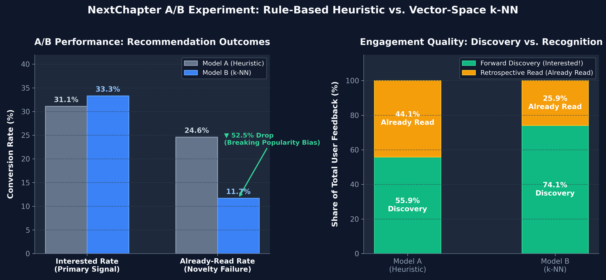

# NextChapter

> Tell it the books you read and loved. It generates a "Wrapped" recap, tells you what to read next, and why it is worth your time!

A personalized book recommendation and reading telemetry app built with Python and hosted on Streamlit.

---

## Recommender Evaluation & The Holdout Paradox

To evaluate recommendation quality, I initially implemented a textbook **Leave-One-Out holdout test** across 37 highly rated (4.0+) books by sequentially hiding one favorite book, rebuilding the user taste profile without it, and checking if the engine recovered the hidden title in its top 5 picks (**Recall@5**).

The test yielded **0% Recall@5**, which highlighted three key dynamics in open-catalog discovery:

1. **Sample Size & Generalizability ($n=37, N=1$):** A single user's reading history of 37 books offers a **directional case study**, not statistical proof. At this sample size, individual quirks in one person's catalog disproportionately skew aggregate percentages.
2. **The Incomplete Ground Truth Problem:** In an open catalog with millions of titles (Open Library), hiding one book does not make it the *only* valid recommendation. In fact, **3 of the 5 books recommended during the test were titles the reader had already read and loved in prior years** (a 60% real-world hit rate)—yet the offline test penalized them as false positives.
3. **The Outlier Erasure Trap:** Hiding a standalone, high-rated book in a genre (e.g., the reader's single historical novel) erased the only evidence of that latent interest. The engine correctly recommended books matching the remaining profile, which mathematically ensured the hidden book would miss.

> **Takeaway:** While offline Recall@K works well on small, closed-world benchmark datasets (like MovieLens), open-web discovery engines require **online evaluation**.

NextChapter tracks this through persistent user events in SQLite (`feedback.db`), measuring true **Precision** via active reader interactions:
- **"⭐ Interested!"** (positive intent / latent interest)
- **"I've Read This!"** (prior affinity verification)

This captures genuine taste alignment in a massive candidate pool rather than penalizing serendipitous or previously validated discoveries.

---

## Online A/B Experiment: Heuristic vs. Vector-Space k-NN

To evaluate recommendation quality with real readers in production, I ran a pre-registered sequential A/B experiment across 7 active readers (182 total recommendation impressions logged) comparing two architectures:

- **Model A (Control — Heuristic):** A 4-pillar rule engine weighting subject affinity (55%), author bonus (20%), community popularity (15%), and book length fit (10%).
- **Model B (Variant — k-NN):** A vector-space model utilizing TF-IDF representations over a composite feature soup (subjects, genres, publication era buckets, and author tokens) scored by cosine distance against a rating-weighted user taste vector.

Hypotheses and evaluation criteria were pre-registered in [`experiments.md`](experiments.md) prior to Model B data collection to preserve scientific integrity.

### Results & Findings

| Metric | Model A (Heuristic) | Model B (k-NN) | Delta / Shift |
|---|---|---|---|
| Recommendations Shown | 61 | 60 | — |
| "Interested!" Actions | 19 | 20 | +1 |
| "Already Read" Actions | 15 | 7 | -8 |
| **Interested Rate (Primary Signal)** | **31.1%** (19/61) | **33.3%** (20/60) | **+2.2%** (+7.0% relative lift) |
| **Already-Read Rate (Popularity Bias)** | **24.6%** (15/61) | **11.7%** (7/60) | **-12.9%** (**-52.5% relative drop**)* |
| **Forward Discovery Share** | 55.9% (19/34) | **74.1%** (20/27) | **+18.2% quality shift** |

*\*Statistically significant at the 10% level ($\chi^2 = 3.40, p = 0.065$).*

### Key Takeaways

1. **Breaking the Popularity Echo Chamber:**
   While Model B delivered a modest directional lift in reader interest (+2.2%), its critical breakthrough was **cutting the "already-read" failure mode by more than half (falling from 24.6% down to 11.7%)**. Hand-tuned heuristics suffered heavily from popularity bias—frequently surfacing mainstream bestsellers readers had already consumed. TF-IDF cosine similarity broke out of this popularity bubble, surfacing relevant yet undiscovered books.
2. **Higher Engagement Quality:**
   In Model A, 44% of all user clicks were retrospective recognition ("I've already read this"). In Model B, **74.1% of all feedback was forward-looking discovery intent ("Interested!")**, yielding 20 active reading discoveries across 53 novel candidates.
3. **Engineering Realities:**
   Beyond vector similarity, production discovery quality depended heavily on pipeline engineering: implementing fuzzy edition deduplication (`SequenceMatcher`), deterministic author ranking, and fair-share candidate harvesting across top-rated authors.

Model B (k-NN) is deployed as the active recommendation engine in NextChapter. Full details and methodology are documented in [`experiments.md`](experiments.md).
